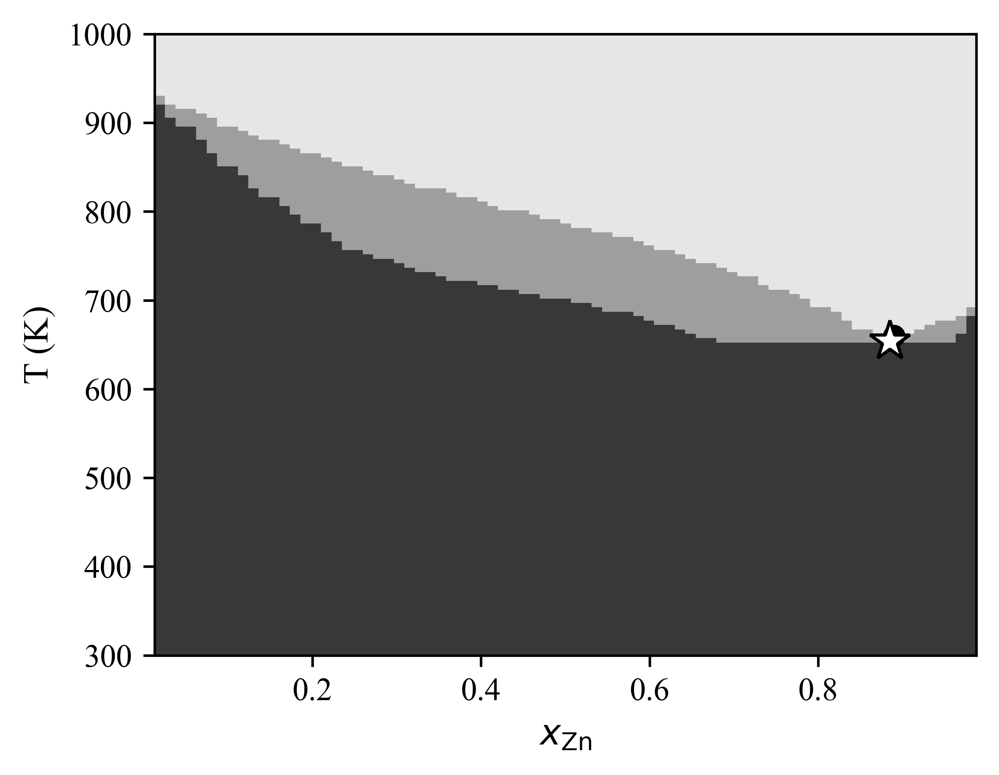

# Hephaestus: an in-browser open-source engine and databases for the thermodynamics and phase diagrams of slags, molten salts, and alloys

Michael E. Bustamante, Gabriel Bustamante

Odinzen LLC, Houston, TX, United States

Corresponding author: Michael E. Bustamante (michaelbustaodinzen.io)

ORCID: Michael E. Bustamante, 0009-0009-9001-8151; Gabriel Bustamante, 0009-0005-3269-024X

**Abstract**

The Modified Quasichemical Model in the Quadruplet Approximation (MQMQA) is the standard description of short-range-ordered ionic melts and underpins the commercial databases used throughout pyrometallurgy, yet no freely licensed oxide slag database has existed, leaving open-tool users the model without parameters. Hephaestus supplies both. The engine is a small dependency-free C core with a Python interface and a WebAssembly build, so the same code runs embedded, scripted, or in a browser with nothing installed. It reads and writes four database formats: ChemSage .dat (MQMQA liquids, compound-energy-formalism solids, stoichiometric compounds); the Thermo-Calc TDB dialect for alloys, with the Inden magnetic model real steel files need; the openly specified uTDB extension carrying MQMQA inside TDB grammar, shown by shipped aluminum-recycling and steelmaking databases; and the community's XML successor XTDB, including its third-generation models, an Einstein heat capacity valid to 0 K and a two-state liquid, shown by Al-C and Pb-Sn examples. One zero-install page calculates across all four. It computes phase equilibria up to ternary isothermal sections and liquidus projections, and Scheil-Gulliver solidification on any binary join. A NASA-polynomial ideal-gas engine, validated against Cantera, couples the furnace atmosphere to the condensed phases at a shared oxygen potential, including to the Modified Quasichemical slag at iron saturation, and the same activity coupling gives the vapour a molten chloride flux fumes off. Every energy path is validated to machine precision against pycalphad, the magnetic model additionally against measured pure-iron transitions. The companion databases span the CaO-SiO~2~, MgO-SiO~2~, FeO-SiO~2~, CaO-Al~2~O~3~, and Al~2~O~3~-SiO~2~ liquids, the FeO-MgO-SiO~2~ and CaO-Al~2~O~3~-SiO~2~ ternaries, a CaO-FeO-MgO-SiO~2~ quaternary with olivine, orthopyroxene, clinopyroxene, and spinel solid solutions, an open chloride salt family from LiCl-KCl to the NaCl-KCl-MgCl~2~ ternary, and an aqueous database for slag minerals in water at 298 K, all from published measurements with per-value provenance. The engine is licensed AGPL-3.0 and the databases CC BY-SA 4.0.

**Keywords:** CALPHAD; molten slag; molten salt; modified quasichemical model; thermodynamic database; phase diagram; gas equilibrium; WebAssembly; open data

## (1) Overview

### Introduction

Molten oxide slags and molten salts are dominated by short-range ordering, which the Modified Quasichemical Model in the Quadruplet Approximation describes through the distribution of cation-anion quadruplets [1]. The quadruplet formalism is the current form of the modified quasichemical family, which grew from the pair-approximation treatment of binary liquids [2] and its application to silicate slags [3]. The model is published in full, and it is the basis of the oxide and salt databases in FactSage, the software that carries most industrial slag work [4]; databases of this kind are embedded in everyday steelmaking practice, from slag design through virtual process simulation [5,6]. These processes are never purely condensed. The furnace atmosphere governs them, because the carbon monoxide to carbon dioxide ratio, and the oxygen partial pressure it fixes, decide whether a metal is reduced or a slag oxidized, so the gas belongs in the same calculation. That gas data lives in yet another open family, the NASA polynomials of combustion and aerospace. What separates a published model from a usable calculation is an implementation and a parameter set. On the implementation side the situation has improved. OpenCalphad brought a free general equilibrium code [7]; pycalphad, itself published in this journal [8], gained an MQMQA model with uncertainty quantification [9] and a companion parameter-fitting framework [10]; Thermochimica calculates MQMQA molten salts inside a nuclear fuel framework [11]. Both MQMQA implementations live inside larger frameworks with correspondingly large dependency stacks. On the data side, open infrastructure has been slower to arrive. The community has argued for years that phase-based data need open infrastructure [12], yet there is no free MQMQA oxide slag database. A student, a startup, or a plant engineer who wants to calculate a slag equilibrium with open tools has the model, possibly an implementation, and no parameters to run through it.

The workflows behind these tools also shape who can use them. FactSage [4] and Thermo-Calc [13] are mature commercial suites whose module interfaces and expertly curated databases serve licensed users well, and other commercial packages follow the same shape. OpenCalphad [7] and pycalphad [8] are free engines for the code-comfortable: command files or Python sessions over TDB databases, with no graphical calculator attached. CemGEMS [14] showed a third way for cement chemistry, a free web front end whose users install nothing, though its calculations still run on a project server; the GEMS ecosystem behind it runs its own container formats entirely, so the fragmentation extends beyond CALPHAD's two dialects. What none of them offers is a calculator that is zero-install, fully client-side, and open-data at once: a page anyone can open, load a database in any of the field's file dialects, and calculate against, with nothing transmitted anywhere. Hephaestus takes that seat deliberately as a complement rather than a competitor. It does not chase FactSage's breadth or Thermo-Calc's alloy depth; it is the low-barrier door into the same published models, with open parameters behind it and a fitting loop short enough that refitting an excess term against new measurements is an interactive step.

The container formats themselves deserve a moment, because they all serve one need, assessed Gibbs-energy functions behind a calculation, yet none reads another (Table 1). The community has begun to move on this: XTDB [15], from the OpenCalphad and NIST circle, proposes a unified successor in XML, the tagged text markup web pages are written in, and its schema already includes the MQMQA model. Its authors weighed keeping the compact human-readable TDB notation against a schema with built-in verification, and chose XML because "even small variations of the TDB format will create problems" [15]: they are engineering for the future toolchain. The present work approaches the same goal from the installed base instead, reading both legacy dialects as they are and publishing a minimal in-place extension, uTDB, for the one model TDB lacks; the two roads are wrappers around one destination, and converting between them is mechanical. Read as a path, the formats run TDB to uTDB to XTDB. This engine reads and writes all three: it parses XTDB directly, including the third-generation models the format was built to carry, an Einstein heat capacity valid to 0 K in place of the older polynomial and a two-state description of the liquid, so the XML successor is a dialect the calculator already reads rather than a future dependency.

Table 1: The schools of thermodynamic database containers. One need, assessed Gibbs energies behind a calculation, split across mutually unreadable families; the present work reads the two CALPHAD dialects and their unified extension in one engine.

| School | Native containers | Carried by |
|--------|-------------------|------------|
| CALPHAD, ChemSage lineage | ChemSage .dat | FactSage, ChemApp, Thermochimica; the only legacy carrier of MQMQA melts |
| CALPHAD, Thermo-Calc lineage | TDB | Thermo-Calc, OpenCalphad, pycalphad; alloy CEF |
| CALPHAD, XML successor | XTDB [15] | unified XML schema, MQMQA and third-generation models included; read by this engine |
| Geochemical / aqueous | GEMS containers, PhreeqC data files | GEM-Selektor behind CemGEMS [14]; speciation models; the slag-weathering database here is a PhreeqC file |
| Combustion / gas phase | NASA-polynomial files (CHEMKIN, Cantera) | ideal-gas and pure condensed species, no solution models |
| First-principles era | JSON records served over the web | calculated formation energies and finite-temperature properties (the Materials Project [16] and kin) |

Hephaestus is a deliberate response to that gap, and it treats the engine and the data as one contribution because neither is useful alone. The engine is small on purpose. Its core is plain C with no dependencies, which makes it easy to embed and lets the identical code compile to WebAssembly, so the full calculator runs in a web browser with nothing installed and no data leaving the user's machine. The database is open on purpose. Every parameter in it derives from published measurements, each value carries its provenance down to table and page, and the known shortcomings are documented next to the numbers they affect. The present work describes both, their validation against pycalphad and against measured phase equilibria, and the ways they can be reused. None of it asks the reader to program. For the experimentalist who never writes code, the browser application is the entire product: a page to open, a database to click, and a diagram to read. The sections that follow describe the machinery underneath for those who want it. Supplementary Material S1 is a plain-language primer for the non-programmer, starting at what a database file is and ending at a first calculation and how to read it. Its closing section teaches what an assessment is built from, so a reader who wants to contribute data for open publication, or to commission a file, arrives knowing what is needed.

### Implementation and architecture

Hephaestus is layered (Figure 1). A C core holds all thermodynamics. A thin Python package calls the C library directly through cffi, so importing it requires a prebuilt shared library and no compiler. An emscripten build compiles the same C into a single WebAssembly file behind a browser application. Nothing in the chain duplicates a formula, so a fix in the core reaches every layer.

![Figure 1: Architecture of Hephaestus. A single dependency-free C core reads and writes the field's database dialects (ChemSage .dat, Thermo-Calc .tdb with the Inden magnetic model, the unified .utdb, and the XML XTDB successor with its third-generation Einstein heat capacity and two-state liquid) and calculates all thermodynamics, including the multiphase equilibria and the meshes of the 3D view; the same core is used as a native library, from Python through cffi, and compiled to WebAssembly behind the browser application. dbbuild writes new ChemSage files from measured data, and every energy path is validated against pycalphad.](figures/fig1_architecture.png){width=6.3in}

The MQMQA in the core is a C translation of pycalphad's MQMQA model [8,9], which implements the Gibbs energy of Pelton, Chartrand and Eriksson [1] as restated by Poschmann et al. [11]: the pair reference energy, the configurational entropy of the quadruplet distribution, and the excess energy with composition-dependent interaction terms, together with the recursive coordination-number rules, including reciprocal quadruplets. It was written with pycalphad's source open, method by method, keeps pycalphad's MIT copyright notice, and follows pycalphad wherever the published equations leave a choice, including the coordination numbers of quadruplets with one mixed sublattice, which pycalphad takes from Thermochimica. Solid solutions use the compound energy formalism (CEF) [17], with sublattice site fractions, per-sublattice ideal entropy, and Redlich-Kister excess terms; the Gibbs energy is normalized per mole of real atoms, so vacancy-bearing phases come out on the same basis pycalphad uses. A reader for the ChemSage data format, the file lineage of the ChemSage and ChemApp equilibrium programs [18], loads MQMQA liquids (SUBQ and SUBG blocks), compound energy formalism phases (SUBL, including the magnetic variant), and stoichiometric compounds, with multi-interval Gibbs functions and the additional-term forms such as T^0.5^ and ln T. The format has no public specification, so the reader's grammar follows pycalphad's open-source parser (the piece of code that turns a database text file into numbers an engine can use), which was read while writing it, and is checked by loading pycalphad's own test databases.

Equilibrium is calculated in the core at two levels. It minimizes the liquid Gibbs energy over quadruplet fractions under element balance, and it carries the multiphase construction, by dense sampling and the lower convex hull, the same global method pycalphad uses, so the browser and the Python package share one implementation. The Python layer adds an exact one-dimensional solve for common-anion binary liquids, where mass balance pins the quadruplet distribution to a single degree of freedom. For a binary the hull yields tie-lines with a test that separates true two-phase edges from adjacent samples of one continuous curve. For a ternary the hull runs over the cation simplex, and each facet is a tie-triangle or tie-line read directly with the lever rule. On top of this sit isothermal sections and liquidus projections for the full FeO-MgO-SiO~2~ system. A refined version of the same hull, whose phase boundaries are located to a set tolerance (0.001 in cation fraction by default) independent of the sampling, drives a three-dimensional view of a three-cation system: the liquidus surface over the composition triangle with its primary-phase fields and eutectic valleys, the isothermal section at any temperature, and the Gibbs energy surfaces, drawn in the browser or exported as meshes.

The same core also reads the Thermo-Calc TDB (thermodynamic database) dialect, the lingua franca of alloy CALPHAD shared by Thermo-Calc [13], OpenCalphad [7], and pycalphad [8]. TDB files parse into the same internal database, so the accessors, the Python layer, and the browser work unchanged, and the format is auto-detected on load. The supported subset covers elements, species, piecewise FUNCTION expressions with nested references, compound energy formalism phases with vacancies, binary Redlich-Kister interactions of any order (ternary interaction parameters are outside the subset and rejected with the stated reason), and the Inden magnetic contribution (TC and BMAGN parameters with their antiferromagnetic factors), which brings real steel files into scope; models outside the subset, such as order-disorder partitioning and the ionic two-sublattice liquid, are rejected with a stated reason rather than calculated incompletely. Temperature extrapolation above a function's last interval follows the Thermo-Calc convention for TDB data while ChemSage data keep their own zero-above convention. MQMQA liquids have no TDB representation, so melts remain the province of the .dat dialect; the two families meet in one engine.

The engine writes as well as reads. A loaded database can be written to any of the four formats the target can hold; a model the target cannot represent, such as an MQMQA liquid bound for plain TDB, is refused by name and no file is written. Written files record their source and the Hephaestus version, round trips agree to 10^-14^ relative, and the suite has pycalphad read the written files back. The MQMQA excess evaluation covers chemical-group interpolation and additional-constituent terms of any order, validated against pycalphad; the multi-anion cases in which the published formalism and pycalphad's implementation differ are refused rather than approximated. One term follows pycalphad rather than the published equation, the weight of reciprocal quadruplets in the composition variables of the G-code terms, and it is credited to pycalphad under its MIT licence. Each database also keeps the gas constant it was assessed with (8.3145, 8.31451, or 8.314462618 J mol^-1^ K^-1^), read from the file where it is stated and otherwise taken from the format's convention, and the writers record it explicitly; one setting can force a single value everywhere.

From Python the calculation chain is three calls, identical for either dialect:

```
from mqmqa import Database
from mqmqa.equilibrium import build_inputs, c_equilibrate

db  = Database.read("FeO-MgO-SiO2-combined.dat")   # or any .tdb
inp = build_inputs(db, db.phase_index("FEO-MGO-SIO2-LIQUID"), 1873.0)
res = c_equilibrate(inp, {"FE": 0.2, "MG": 0.2, "SI": 0.2, "O": 0.8})
# res["GM"], res["X"]: molar Gibbs energy and the quadruplet distribution
```

Read as plain steps: the two import lines fetch the named tools from the installed package. Database.read opens the file, detects its dialect, and loads every phase and parameter into memory. build_inputs gathers what the solver needs about one named phase at one temperature, here the slag liquid at 1873 K. c_equilibrate then finds the internal state of lowest Gibbs energy for the given amounts of each element, here 0.2 mol each of FeO, MgO and SiO~2~ (amounts that do not balance the ionic charges are refused), and returns a small table: res["GM"] is the molar Gibbs energy and res["X"] is the melt's internal structure, the quadruplet fractions. Every calculation in this paper is some loop around these three calls.

The Python package also contains dbbuild, a declarative route from measured data to a loadable database. A user describes components with sourced endmember thermodynamics and fitted binary excess terms, and dbbuild writes a valid ChemSage file; a fitting routine obtains the excess parameters from measured component activities using the engine itself as the forward model. The builder covers single-anion oxide systems of two to four components, and multicomponent liquids are assembled from their binaries in the usual way.

The browser application, hosted at https://odinzen.github.io/hephaestus-mqmqa-public/, exposes eleven tools. A calculator works over any loaded database (ChemSage .dat, Thermo-Calc .tdb, uTDB, or XTDB, auto-detected, with every uploaded file kept as a reload button for the session), and any loaded database can be saved again in another of the four formats. A binary-join phase-diagram tool offers tap-to-read point comparison, and a Scheil-Gulliver solidification panel on the same join draws the equilibrium lever-rule path alongside. A viewer shows the assessed FeO-MgO-SiO~2~ diagrams, and a live isothermal-section solver calculates the full phase assemblage at a chosen temperature in a second or two, for the shipped ternaries or for any loaded three-cation file (Figure 2). A crystallization viewer shows which silicate crystallizes first from a CaO-FeO-MgO-SiO~2~ steelmaking slag at 5 mol% FeO, and at what temperature (Figure 3), and a three-dimensional view draws a ternary's liquidus surface with a movable isothermal plane, computed in background workers so the page stays responsive. An interactive eutectic builder pre-fills its component names, melting points, and fusion enthalpies from the loaded database. A gas-equilibrium calculator solves ideal-gas equilibrium over an open NASA-polynomial database, its own engine compiled into the same WebAssembly core, and optionally couples that gas to a steelmaking condensate (graphite, wustite, iron) so a reducing atmosphere pulls the oxide down to metal and an oxidising one holds it, calculated at a shared oxygen potential. A slag-gas readout closes the same loop for the solution melt: for the assessed FeO-SiO~2~ slag held at iron saturation it shows the FeO activity and the furnace CO~2~/CO ratio and oxygen pressure the melt equilibrates with, so adding silica lowers the activity and drives the equilibrium gas more reducing. The same readout switches with the loaded chemistry: for a molten chloride flux it shows the fume, each salt's partial pressure taken as its engine activity times its measured pure-component vapour pressure, so that magnesium chloride, held in the melt by chlorocomplexing, contributes only a few percent of the vapour despite being a fifth of the flux. Loading an alloy TDB reshapes the workspace: the elements become the end members and every compound energy formalism phase spanning the join enters the same convex hull construction. A further card calculates the binary diagram of any loaded XTDB file, and a library window lists the shipped databases, those being assessed, and those planned. Everything runs client side, and the page works offline once its folder is copied to the machine. Its content security policy refuses every connection to another server, it escapes all file-derived strings, and it never transmits a loaded file, which matters to industrial users whose compositions are confidential; the only things it stores, in the browser itself, are display preferences and finished 3D surfaces.

{width=5.2in}

The database is the second half of the contribution. Endmember oxide thermodynamics come from open compilations, chiefly Robie and Hemingway [19] and the NIST-JANAF tables [20]. Liquid excess parameters are fitted to published measurements: Knudsen-effusion and gas-slag equilibrium activities for CaO-SiO~2~ [21,22], the measured iron-saturated activities collected by Björkman for FeO-SiO~2~ [23], and the melting and immiscibility constraints of the classical phase diagram studies [24-26]. Solution-calorimetric compound enthalpies [27] anchor the solids. Where published calorimetry cannot constrain a liquid, melt-mixing enthalpies from machine-learned interatomic potentials [28,29] serve as auxiliary anchors after bias correction against measured formation enthalpies; each such use is recorded in the provenance files. First-principles codes sit upstream of this pipeline. A density functional theory (DFT) engine such as Quantum ESPRESSO [30] or VASP [31] calculates the energy of one configuration at a time, at zero kelvin unless phonon or molecular-dynamics machinery is layered on top. It supplies candidate data for an assessment to weigh, not assessed multicomponent Gibbs functions, and repositories such as the Materials Project [16] serve such results at scale. That physics enters the present databases only through potentials trained on large DFT corpora. MatterSim [28] and Orb [29] supply the melt anchors above, and a further graph-network potential, SevenNet [32], was used to corroborate the olivine mixing enthalpy against the calorimetric record [33] through configuration-averaged relaxed supercells, with endmember differences cancelling any constant offset; the check is recorded in the repository and changed no fitted parameter. The olivine solid solution takes its endmembers from Robie and Hemingway [19] and its mixing parameters from solution calorimetry [33]. Orthopyroxene is a two-site model whose Fe-Mg order between the M1 and M2 sites is held at internal equilibrium, assessed against measured site occupancies [34], olivine-pyroxene tie-lines [35], the ferrosilite-fayalite-quartz equilibrium [36], and solution calorimetry [37], with the enstatite heat capacity above 800 K taken from drop calorimetry [38] rather than extrapolated. A magnesiowüstite (Fe,Mg)O solution, fitted to measured coexisting magnesiowüstite-olivine compositions and activities [35], replaces separate periclase and wüstite. The assembled ternary reproduces the topology of the measured MgO-FeO-SiO~2~ liquidus surface [24], with the olivine liquidus within a mean 21 K of the measured points and the known offsets stated. No parameter is taken from any prior assessment or commercial database; published assessments of these systems [39] are used only as method literature. The library also ships the calcium-aluminosilicate family that anchors cement and blast-furnace slag chemistry: the CaO-Al~2~O~3~ and Al~2~O~3~-SiO~2~ binaries and the CaO-Al~2~O~3~-SiO~2~ ternary, the ternary carrying three ternary-level terms fitted to the Rankin liquidus [40] and to 45 measured silica activities, 21 by Knudsen effusion [41] and 24 from gas-slag equilibrium [21]. A melt-mixing feasibility check on the aluminate edges with three foundation machine-learned potentials [28,29,32] found unanimous sign and a spread of about 7 kJ per mole of oxide on the strongly ordering CaO-Al~2~O~3~ edge, but a spread from near-ideal to strongly positive on Al~2~O~3~-SiO~2~; the aluminosilicate excess is therefore held to the measured activities rather than to potential energies, the run recorded in the provenance. A CaO-FeO-MgO-SiO~2~ quaternary combines the three assessed silica binaries with silicon in its own chemical group, an asymmetric (Toop-like) extrapolation, reducing to each exactly at its edge, with ternary terms assessed on its CaO-MgO-SiO~2~ and FeO-MgO-SiO~2~ faces and the rest of the interior a stated prediction. Two further compound-energy solid solutions, clinopyroxene (diopside-hedenbergite) and spinel (spinel-hercynite), extend the crystallization fields; both ship with ideal mixing, the excess left unfitted where no open calorimetry constrains it and machine-learned potentials disagree even in sign, each such judgment recorded in the provenance. The same engine and file format also serve molten salts: the repository ships an open chloride family alongside the slags (LiCl-KCl, NaCl-KCl with its continuous halite solid solution, KCl-MgCl~2~ with the double salt KMgCl~3~, NaCl-MgCl~2~, and the assembled NaCl-KCl-MgCl~2~ ternary), built the same way from evaluated endmember tables [42], measured mixing calorimetry [43], and the measured eutectic, liquidus, and solvus record of the halide literature [44], with LiCl-KCl, and the NaCl-KCl-MgCl~2~ flux inside the aluminum-recycling uTDB, loadable in the browser application with one click. The nuclear community's MSTDB-TC [45] covers molten salts for reactor work under a registration license; the chloride family here is complementary, small, and CC BY-SA. Each system folder carries a provenance file that names every source, every modeling judgment, and every known limit. The largest limits are stated plainly. In CaO-SiO~2~ the silica-rich two-liquid region does not close: refits that close it near its measured top drive the silica liquidus about 150 K low, so the shipped liquid keeps the liquidus, and the error is confined to melts above about 65% SiO~2~ above about 2000 K. In MgO-SiO~2~ the top of the two-liquid dome is 330 K high and forsterite melts 83 K low. Figure 4 shows the assembled ternary as the engine calculates it from the shipped database files, in the two views the application offers; Table 2 summarizes each fitted liquid, the data behind it, and what it reproduces. The engine is licensed AGPL-3.0 at the repository root and the database directory carries its own CC BY-SA 4.0 license; releases up to v0.6.1 keep their original MIT and CC BY 4.0 terms.

The same solid descriptions also follow the slag out of the furnace. Slags are stockpiled, landfilled, or reused in construction, where rain and groundwater dissolve them, and the pH and composition of that leachate decide what can be done with the material. The repository therefore ships an aqueous database for slag minerals at 298 K in the PhreeqC format [46]. Dissolution constants for sixteen anhydrous slag minerals, from lime and the calcium aluminates to forsterite, diopside, and anorthite, are derived from the same Gibbs energies the high-temperature databases ship, through an exchange cycle against portlandite, gibbsite, quartz, and forsterite in which the aqueous ions, and with them any element-reference convention, cancel. Hydrates and calcium silicate hydrate (C-S-H) come from Cemdata18 [47]. Against measured solutions the database places gibbsite in the calcium aluminate experiments of Wells, Clarke and McMurdie at 294 K [48], with the constants carried to that temperature by their reaction enthalpies, at a mean saturation index of -0.33 (root-mean-square 0.38 over 20 solutions), reproduces the amorphous-silica saturation indices reported for magnesium silicate hydrates at 293 K [49] within 0.06, and gives C-S-H with Ca/Si 0.67 in equilibrium with basic-oxygen-furnace slag leachates, against 0.71 ± 0.15 measured on the weathered sand fraction [50]. Its limits are stated with it. Katoite sits about two log units undersaturated in the Wells solutions, a disagreement already present between Cemdata18 and those measurements before any conversion here. The database carries no sulfate, carbonate, iron, or redox chemistry, and it treats every mineral as reacting to equilibrium, which overstates the room-temperature dissolution of slow formers such as spinel and forsterite.

{width=6.2in}

![Figure 4: The assessed FeO-MgO-SiO~2~ system calculated from the shipped database files. (a) Liquidus projection: each colour is the field of one primary crystallizing phase, with liquidus isotherms labeled in K. (b) Isothermal section at 1873 K: stable phase assemblages. A field where liquid coexists with one solid is a pale tint of that solid's colour, and the grey triangle is liquid + magnesiowüstite + olivine. Both panels are computed from the engine's equilibrium with the liquid refined near phase boundaries, and read on a grid of 150 (a) and 110 (b) steps per side of the triangle; each field edge is smoothed by less than one grid step for display. Phase labels: L liquid, Crs cristobalite, Ol olivine, Opx orthopyroxene, Mw magnesiowüstite.](figures/fig3_ternary.png){width=6.5in}

Table 2: The assessed liquids. Full source lists, modeling judgments, and limits are in each system's provenance file in the repository.

| System | Fitted liquid excess (J/mol) | Fitted to | Reproduces; known limit |
|------|---------------|--------------|----------------|
| CaO-SiO~2~ | five terms in χ~Si~^q^ for q = 0, 1, 3, 5, 7, the first two a + b T | the invariants of Abdul et al. [51], the immiscibility data [25,26], and silica and lime activities [21,22] | CaSiO~3~ and Ca~2~SiO~4~ melting and the CaSiO~3~ + SiO~2~ eutectic within 30 K; monotectic 9 K high; the silica-rich two-liquid region does not close (two liquids at 3000 K, measured top 1998 K); lime-side invariants 95 to 134 K off; the lime activities of [22] missed about sixfold |
| MgO-SiO~2~ | seven terms, Y~SiO2~^q^ for q = 0, 1, 2, 3, 5, 7 and Y~MgO~^4^, each a + b T; a heat-capacity excess on liquid MgO | the invariants of Bowen and Andersen [52], the immiscibility data [25,26], the forsterite fusion enthalpy [53], and solution calorimetry [27], fitted jointly with the CaO-MgO-SiO~2~ [54] and FeO-MgO-SiO~2~ liquidus | enstatite peritectic, enstatite-cristobalite eutectic, and monotectic within 20 K; forsterite melts 83 K low (2080 K) with too small a fusion enthalpy, the periclase-forsterite eutectic is 75 K low, and the top of the two-liquid dome is 330 K high |
| FeO-SiO~2~ | (-58714 + 40.27 T) - 28133 χ~Fe~ - 24368 χ~Si~^3^ + 102533 χ~Si~^5^; a slope on liquid FeO below 1650 K | 12 liquidus points and the two-liquid point of Bowen and Schairer [55], and 23 iron-saturated activities [23] | activities within 0.03 in ln a (RMS); fayalite melts congruently at 1475 K (measured 1478 K); both eutectics within 9 K; monotectic 26 K low |
| FeO-MgO-SiO~2~ | the binaries plus three assessed terms: FeO-MgO edge +9065, Fe-Si with Mg -6604, Mg-Si with Fe +16775 | the liquidus of Bowen and Schairer [24] and the solidus of Nafziger and Muan [35], fitted jointly with MgO-SiO~2~ | olivine liquidus within a mean 21 K (23 points), pyroxene 19 K, silica 11 K; 29 of 37 primary phases as measured; solidus 36 to 42 K low |
| CaO-Al~2~O~3~ | five terms (a + b T) χ~Ca~^p^ χ~Al~^q^ with p + q up to 2; the CaAl~4~O~7~ and Ca~3~Al~2~O~6~ formation enthalpies moved 14.1 and -6.8 kJ (3.0 and 2.3 σ) off their calorimetry | the dry invariants and fusion heats of Jerebtsov and Mikhailov [56] and the liquidus of Shepherd and Rankin [57] | dry, so no Ca~12~Al~14~O~33~; the eutectic and the CaAl~4~O~7~ and Ca~3~Al~2~O~6~ peritectics within 20 K; hibonite breaks down 65 K high and CaAl~2~O~4~ 41 K low; liquid activities not constrained |
| Al~2~O~3~-SiO~2~ | (80192 - 23.25 T) + (-1235 - 0.75 T) χ~Si~^5^ + (-23050 - 2.08 T) χ~Al~ | the liquidus of Bowen and Greig [58] | eutectic 1846 K at x~AlO1.5~ = 0.064 (measured 1818 K, 0.064); mullite liquidus within 31 K; mullite melts congruently here, so corundum does not crystallize first at 70.6 wt% Al~2~O~3~ |
| CaO-Al~2~O~3~-SiO~2~ | the binaries plus three ternary terms: Ca-Si with Al +44 kJ, Al-Si with Ca -107 kJ, Ca-Al with Si -178 kJ | the liquidus of Rankin [40] and 45 silica activities, 21 by Knudsen effusion [41] and 24 from gas-slag equilibrium [21] | anorthite field within a mean 45 K, gehlenite 25 K, 65 of 84 primary phases as measured; RMS ln a(SiO~2~) 0.23 (gas-slag) and 0.82 (Knudsen effusion); ternary eutectics about 150 K high; two terms 2 to 3.6 times their priors |
| CaO-FeO-MgO-SiO~2~ | three silica binaries, the FeO-MgO-SiO~2~ terms, and three CaO-MgO-SiO~2~ terms (CaO-MgO +11.5, Ca-Si with Mg +3.2, Mg-Si with Ca -3.9 kJ); CaO-FeO ideal; no quaternary term | the CaO-MgO-SiO~2~ face fitted to 40 liquidus points of Bowen [54], jointly with MgO-SiO~2~ | reduces to each binary and to the FeO-MgO-SiO~2~ liquid exactly; 36 of 40 primary phases on the CaO-MgO-SiO~2~ face, diopside melting at 1673 K (measured 1664 to 1670 K); the CaO-FeO-SiO~2~ face carries a two-liquid region no measurement supports, and the interior is a prediction |

### Anatomy of a database file

Because the database is half the contribution, it is worth stating plainly what such a file is. A ChemSage-format database is a self-contained plain-text file; the fitted binaries here are 52 to 67 lines, and the combined ternary with its three solid solutions is 209. Those lines hold everything the calculation needs. The file opens with the elements and their masses. Each liquid carries its endmember Gibbs-energy functions as interval-wise polynomial coefficients, its cation charges and chemical groups, its quadruplet coordination numbers, and its excess terms with their composition exponents. Each solid solution lists its sublattice constituents, site ratios, and interaction terms, and each stoichiometric compound is a single line of coefficients. Nothing is opaque: every parameter that enters a calculated diagram can be read directly from the file.

The brevity of the file is inverted in the effort behind it. Building one from scratch, as done for each system here, starts with locating and triaging the primary literature, then extracting measurements with per-value provenance, including digitization from sixty-year-old figures. Endmember functions are assembled from evaluated compilations, the model structure is chosen, and the excess is fitted with the engine as the forward model. The result is checked against pycalphad and against measurements withheld from the fit, and the limits are written down. Because a liquidus is set by the Gibbs energy of the liquid minus that of the coexisting solid, every boundary-setting phase carries its own assessed description here, the terminal oxides and intermediate compounds from the evaluated tables and solution calorimetry and the olivine solution from calorimetric mixing parameters and the two-site orthopyroxene from measured site occupancies, tie-lines and calorimetry, rather than being frozen as pure elements; the liquid excess is fitted against those real solid descriptions, so it is not left to absorb a missing solid contribution, and the fitted interaction stays physically transferable. The steps that resist automation are judgments: conflicting data sets must be arbitrated, reference states reconciled, and model-form limits recognized rather than papered over with additional terms. dbbuild automates the mechanical part of this pipeline; the judgment does not compress.

That asymmetry is the economics of the field in miniature: implementations of the published models are increasingly available, but each fitted parameter condenses dozens of measurements and decisions. Parameter sets rather than codes are therefore the scarce commodity, and an openly licensed, provenance-tracked database is the part of this contribution that cannot be regenerated from the paper alone.

### Quality control

pycalphad is the reference throughout, and Table 3 lists the checks. Because the MQMQA energy is translated from pycalphad, agreement on that term shows the translation is faithful; it is not an independent test of the model. The pytest suite, 742 test cases in 63 files, compares every energy contribution on shared parameters and agrees to about 10^-10^ J per mole of atoms. A further guard requires each fitting script's solid-phase Gibbs energies to equal, within 1 J, those in the database file it produces, so a system cannot be fitted against one description and shipped with another. The reader proves itself the hard way, by loading pycalphad's own test databases and reproducing their energies with no pycalphad at runtime. The compound energy formalism kernel matches pycalphad on a real multicomponent industrial file with charged species, vacancies, and logarithmic temperature terms. The multiphase construction is tested end to end: a combined file holding the MQMQA liquid, three solid solutions (olivine, orthopyroxene, magnesiowüstite), and cristobalite runs through pycalphad's own equilibrium calculation. At five interior probe points at 1560 K, four independent solver routes in the engine give pycalphad's stable phase sets at every point, with Gibbs energies within 10 J per mole of atoms. The WebAssembly build is validated in the browser against the same oracle values to machine precision. The TDB front-end is validated the same way, with pycalphad's own shipped test databases as the corpus: the subset-compatible alloy systems (Al-Zn, Pb-Sn, Al-Mg) load, and every solution phase matches pycalphad's Gibbs energy at random site fractions and temperatures to about 10^-10^ J per mole of atoms, line compounds included, while out-of-subset files must fail with the stated reason, and the suite asserts those failures too. The magnetic model is checked twice over: pycalphad parity on its own magnetic test database and on an own-transcribed Fe-C system, whose pure-iron transitions, carried almost entirely by the magnetic term, come out at 1185, 1668, and 1811 K against the measured 1184.8, 1667.5, and 1811. The Scheil panel is checked against known invariants: for Al-Zn at 30 mol% Zn it nucleates FCC_A1 at 836 K and freezes the 12.5% residue within one temperature step of the assessed 654 K eutectic [59]; for LiCl-KCl the residue freezes at 629 K against the measured 626 K.

Table 3: Validation against pycalphad. Every check runs in the pytest suite except the in-browser one, which is exercised manually per release.

| Check | Scope | Agreement |
|---|---|---|
| Energy paths (MQMQA reference, ideal, excess; CEF; stoichiometric) | shared parameter sets, every phase model | ~10^-10^ J per mole of atoms |
| ChemSage reader | pycalphad's open test databases, no pycalphad at runtime | energies reproduced to machine precision |
| CEF kernel | multicomponent industrial file with charges, vacancies, ln T terms | machine precision |
| Multiphase equilibrium | liquid + three solid solutions + cristobalite, 5 interior points at 1560 K, four solver routes | phase sets at every point; Gibbs energies within 10 J per mole of atoms |
| WebAssembly build | in-browser against the same oracle values | machine precision |
| TDB reader | pycalphad's shipped alloy TDBs (Al-Zn, Pb-Sn, Al-Mg), every phase and line compound | ~10^-10^ J per mole of atoms |
| TDB magnetic model | pycalphad parity + measured pure-iron transitions | matches to 10^-10^; 1185/1668/1811 K |
| TDB scope guard | ionic-liquid and order-disorder test files | rejected, with the reason asserted |
| Gas phase | NASA-polynomial ideal-gas equilibria (Python and C core); Peng-Robinson real gas | within 10^-5^ mole fraction of Cantera [60] with the full GRI-Mech 3.0 set, 1200-2400 K, 0.5-5 atm; real-gas compressibility within 5 x 10^-3^ of Cantera's Peng-Robinson |
| Gas-condensed coupling | shared-element-potential solve, gas + stoichiometric metals/oxides (Boudouard, FeO reduction) | Cantera multiphase parity to 2 x 10^-3^ mole fraction, to 10^-9^ on shared thermodynamic data |
| Gas-slag coupling (iron-saturated) | gas + MQMQA slag through the FeO activity; equilibrium CO~2~/CO vs slag composition | pure-FeO limit within 1% of the Cantera Fe/FeO buffer; slag activity matches the fitted iron-saturated data |
| Gas-flux coupling (chloride fume) | gas + MQMQA salt through component activities; fume partial pressures p~i~ = a~i~ p~i~^o^ vs temperature | pure limit gives unit activity to five figures; NaCl-KCl binary reproduces the measured near-ideal negative deviation; pure-component vapour pressures reproduce the measured boiling points |

The database is tested against measurements rather than against other software. Endmember fusion points reproduce their sources exactly. The fitted FeO-SiO~2~ liquid reproduces the 23 measured iron-saturated activities [23] to 0.03 in ln a (root mean square, the supercooled points up to one fitted offset), and the fitting route itself is regression-tested by re-deriving the earlier activity-only fit from the raw data. Fayalite melts congruently 3 K below measurement. Forsterite melts 83 K low, the main known shortfall of the MgO-SiO~2~ liquid, whose other invariants sit within 25 K except the periclase-forsterite eutectic (75 K low) and the top of the two-liquid dome (330 K high). The ternary liquidus falls within a mean 21 K of 23 measured olivine-field points [24]. Development practice is plain: the repository is version controlled with tagged releases (v0.1.0 through the v0.7.0 described here), the full suite runs before every release, and a fixed bug lands together with the regression test that would have caught it. The suite runs on Windows 11 under CPython 3.13; the browser application is exercised in Chromium- and Gecko-based browsers. A user can confirm a working installation by running pytest against the bundled test databases, or with no installation at all by opening the web application and loading the shipped ternary database.

## (2) Availability

### Operating system

Platform independent. The core builds with any C99 compiler; development and testing used Windows 11. The browser application runs in any current browser with WebAssembly support.

### Programming language

C (core), Python 3.11 or later (interface and fitting tools), JavaScript (browser application).

### Additional system requirements

None of note. The engine and database together are a few megabytes.

### Dependencies

Python interface: cffi, NumPy, SciPy (developed and tested with cffi 2.0, NumPy 2.4, and SciPy 1.17). The validation suite additionally requires pycalphad, and Cantera for the gas checks; every oracle comparison reported here ran against pycalphad 0.11.1 and Cantera 3.2.0, and the tests read pycalphad's own shipped test databases from its installed package. The optional mesh export of the 3D module uses PyVista. The WebAssembly build requires emscripten. The C core has no dependencies, and the browser application bundles its one library, Three.js (MIT), for the 3D view.

### List of contributors

Michael E. Bustamante (design, implementation, validation, data curation, writing - original draft). Gabriel Bustamante (software, software validation, writing - review and editing).

### Software location

**Archive**

- Name: Zenodo
- Persistent identifier: [Zenodo DOI, assigned at release]
- Licence: AGPL-3.0 (code), CC BY-SA 4.0 (database)
- Publisher: Michael E. Bustamante
- Version published: v0.7.0
- Date published: [release date]

**Code repository**

- Name: GitHub
- Identifier: https://github.com/odinzen/hephaestus-mqmqa-public
- Licence: AGPL-3.0 (code), CC BY-SA 4.0 (database, under data/)
- Date published: 2026-09-09
- Citation metadata: CITATION.cff in the repository root

### Language

English.

## (3) Reuse potential

The nearest reuse is interoperation. Every database in the repository's data directory is a standard ChemSage file: pycalphad opens the same files this engine ships, files written by dbbuild load in both tools, and the test suite enforces that compatibility on every run, so a group already working in pycalphad can adopt the databases alone and ignore the engine. The reverse path holds too. A TDB an OpenCalphad or Thermo-Calc user already has loads in the browser unchanged, within the documented subset. A group that needs an embeddable solver can take the C core, one source directory of C99 with no dependencies, compiled by any C compiler. Its flat application binary interface (ABI) covers database reading and writing, phase and parameter access, Gibbs evaluation, liquid and multiphase equilibrium, the gas engine, the XTDB reader, and the 3D meshes, callable from C, Python, or anything with a C foreign-function interface. The WebAssembly build is that same ABI passed through emscripten. The same core also exposes a thermodynamic application interface shaped like OpenCalphad's OCASI (the de-facto embedding standard, descended from Thermo-Calc's TQ), with its function shapes taken from OpenCalphad's C binding, so software built to drive OpenCalphad can bind this engine instead, including in the browser, where the Fortran reference does not run; the interface is checked against pycalphad in the suite. Adopting uTDB is a reuse path of its own: the open specification together with the three shipped demonstration files and their round-trip suites amounts to a conformance kit for any implementation that wants to carry MQMQA inside TDB grammar.

The browser application makes the lowest barrier the default. A lecture on slag thermodynamics, a plant metallurgist screening a composition, or a reviewer checking a claimed equilibrium can load the database and calculate in seconds, with confidential inputs never leaving the machine. The same property makes it a practical template for other groups who want to publish a model as a zero-install tool.

### Worked examples

Two complete sessions show the public API end to end. Both run against the shipped files as printed (the alloy session's ten-line lower_hull helper is printed in the repository copy), and Figures 5 and 6 are drawn from their output by plotting scripts kept in the repository. The salt session calculates the LiCl-KCl phase diagram:

```
import numpy as np

from mqmqa import Database
from mqmqa.equilibrium import build_inputs, multiphase_binary

db  = Database.read("web/LiCl-KCl.dat")         # the file the browser app ships
liq = db.phase_index("LICL-KCL-LIQUID")
LiCl, KCl = {"LI": 1, "CL": 1}, {"K": 1, "CL": 1}  # endmember compositions

diagram = []
for T in np.arange(500.0, 1101.0, 10.0):
    inp    = build_inputs(db, liq, T)         # liquid model at this temperature
    solids = [(0.0, db.stoich_gibbs(0, T), "LiCl(s)"),
              (1.0, db.stoich_gibbs(1, T), "KCl(s)")]
    for xi in np.arange(0.025, 1.0, 0.025):        # xi = mole fraction KCl
        state = multiphase_binary(inp, LiCl, KCl, solids, xi, ngrid=80)
        diagram.append((xi, T, "+".join(sorted(state["phases"]))))

liquid_only = [(T, xi) for xi, T, ph in diagram if ph == "LIQUID"]
Te, xe = min(liquid_only)                  # coldest all-liquid point = eutectic
```

In plain terms, the session sweeps temperature and composition steps, and at each point multiphase_binary compares the liquid solution against the two solid salts and reports which phases coexist. The two stoich_gibbs lines fetch the Gibbs energies of solid LiCl and solid KCl at that temperature. The closing lines only search the results: among all points where the melt is entirely liquid, the coldest is the eutectic.

The listing prints its eutectic at x~KCl~ = 0.400 and 640 K at this deliberately coarse step size, against the measured 0.415 and 626 K; Figure 5 is the diagram it draws.

{width=4.6in}

The alloy session reads the Thermo-Calc dialect through the same API and calculates the Al-Zn diagram with a ten-line convex hull:

```
import numpy as np

from mqmqa import Database

db = Database.read("web/AlZn.tdb")            # Thermo-Calc dialect, same reader
phases = [(db.phase_index(n), n) for n in db.phase_names]

diagram = []
for T in np.arange(300.0, 1001.0, 5.0):
    pts = []
    for p, name in phases:                      # every CEF phase along the join
        for y in np.linspace(1e-4, 1-1e-4, 60):
            g = db.cef_gibbs(p, [1.0-y, y], T, per_mole_atoms=True)
            pts.append((y, g, name))
    hull = lower_hull(pts)                     # 2-D lower convex hull of (x, G)
    for edge_a, edge_b in zip(hull, hull[1:]):
        xa, _ga, name_a = edge_a
        xb, _gb, name_b = edge_b
        diagram.append((0.5*(xa+xb), T, tuple(sorted({name_a, name_b}))))
```

In plain terms: at each temperature the loop evaluates every solid-solution phase's Gibbs energy across the whole composition line (cef_gibbs), and lower_hull keeps only the states no mixture of others can beat, the geometric equivalent of the common-tangent construction. Where two neighboring hull points belong to different phases, those phases coexist.

It locates the eutectic at x~Zn~ = 0.890 and 660 K against the assessed 0.885 and 654 K [59] (Figure 6). The shipped AlZn.tdb is itself an openly licensed transcription of that published assessment on the Scientific Group Thermodata Europe (SGTE) unary functions [61], verified bit-identical through pycalphad against the file it transcribes. The slag systems run through the same calls behind Figures 2 to 4, and the repository's validation scripts are their executable record.

{width=4.6in}

The database is a starting point rather than an endpoint, and the file format rewards growth: new components, new phases, and refits against new measurements accumulate in the same database. A system is therefore extended release by release rather than rebuilt, and archived versions keep results calculated against earlier releases reproducible. Because every value carries its source and every judgment is written down, another assessor can reweight the data, swap an endmember, or extend a system without reverse-engineering anything; dbbuild turns a table of measured activities into a loadable file in a few lines. The in-browser multiphase hull already covers any loaded three-cation file and any loaded alloy TDB join, so a new system becomes a browser phase diagram the moment its file loads. Natural extensions are further oxide systems, the remaining ChemSage solution models, the ionic-liquid TDB model, and multicomponent Scheil on the same hull machinery. The databases carry per-value provenance but not parameter uncertainties; refitting the same measured-data tables through ESPEI [10] to obtain Bayesian uncertainty bounds on the parameters is demonstrated below. A first reach into the combustion school is already in the library. The engine reads NASA 7-coefficient polynomial thermochemistry, the open format of NASA CEA [62] and GRI-Mech [63], and solves ideal-gas equilibrium at fixed temperature and pressure by the element-potential method, validated against Cantera [60] to within 10^-5^ mole fraction from 1200 to 2400 K and 0.5 to 5 atm. The same solver is compiled into the WebAssembly core, so it runs in the browser gas calculator alongside the condensed engine. For the dense conditions of pressurized reactors and gasifiers, a Peng-Robinson real-gas option applies fugacity corrections from tabulated critical constants, validated against Cantera's own Peng-Robinson and reducing to the ideal result at atmospheric pressure. The gas is coupled to the condensed phases in one equilibrium, the step that carries pyrometallurgical oxygen potentials: a shared set of element potentials holds the ideal gas and the pure condensed species (metals, oxides, graphite) at a common oxygen potential, and the stable phase assemblage is the set of lowest total Gibbs energy, so the furnace atmosphere and the condensate settle together rather than apart. The solver reproduces Cantera's own multiphase equilibrium on the reactions that carry those potentials, the Boudouard balance C(gr) + CO~2~ = 2 CO and iron-oxide reduction FeO + CO = Fe + CO~2~, to within 2 x 10^-3^ mole fraction, and to 10^-9^ where the two are given identical thermodynamic data so that only the coupling is under test. That condensate is the set of stoichiometric metals and oxides; the same shared oxygen potential also couples the gas to the Modified Quasichemical slag itself. At iron saturation the melt, metallic iron and the gas meet at one oxygen potential, and the slag enters through its FeO activity (a quantity the engine already evaluates, validated against the iron-saturated activity measurements the database was fitted to), so a more silica-rich melt, with its lower FeO activity, sits under a more reducing gas, exactly as slag-gas equilibration measurements show. The pure-FeO limit recovers the Fe/FeO buffer to within a percent of Cantera's own multiphase equilibrium. The uTDB grammar already defines the ideal-gas phase, so a single file carries an alloy, a slag, its solids, and a gas for one coupled calculation. The repository also publishes an openly specified unified dialect (uTDB) that carries the MQMQA statements inside TDB grammar, with three shipped demonstration files chosen to be processes rather than curiosities: two aluminum-recycling databases holding the Al-Zn alloy with a NaCl-KCl-MgCl~2~ or a LiCl-KCl salt, and a steelmaking database holding a basic Fe-C steel, magnetic phases included, with the FeO-MgO-SiO2 slag and its silicate solid solutions. Round-trip tests assert that all three reproduce their source-file physics at machine precision. The steelmaking file is the clearest illustration of what a unified container buys (Figure 7): from one file the browser calculates the iron-carbon alloy diagram through the magnetic compound energy formalism and its Scheil solidification path, while the same file's slag is a molten-salt-model liquid, two physics that no single legacy container holds together. The furnace atmosphere over that bath is calculable on the same page, and Figure 8 works it through with the gas calculator: the CO to CO~2~ ratio of a carbon-oxygen gas fixes the oxygen partial pressure that decides whether carbon is removed from the steel or iron is oxidized into the slag, both at the 1873 K tap temperature and across the steelmaking range, with the gas engine reproducing Cantera throughout. The salt side of the same coupling is the fume over a molten chloride flux (Figure 9): each salt evaporates at its engine activity times its measured pure-component vapour pressure, so magnesium chloride, a fifth of the NaCl-KCl-MgCl2 flux, is only a few percent of the fume, because chlorocomplexing holds its activity far below its mole fraction. The engine's validated activities are what separate that fume from a Raoultian estimate. The same engine also carries parameter uncertainty to the diagram. Refitting the Al-Zn liquid and face-centred-cubic excess parameters against the measured liquid enthalpy of mixing and the assessed phase boundaries [59,64,65] by Markov-chain Monte Carlo, and propagating the posterior through the browser calculation, produces the confidence band of Figure 10. Three excess coefficients were sampled, the liquid enthalpy and its temperature term and the face-centred-cubic enthalpy, by an ensemble of eighteen walkers over 1500 steps under ESPEI's default equal dataset weighting, discarding the first half as burn-in; the walker-mean chains are stationary and well mixed (Gelman-Rubin R-hat at most 1.04), the effective sample size is of order 400, and no pair of parameters correlates above about 0.65. Because only these three excess terms are varied while the SGTE unary functions and the phases not being refitted are held at their assessed values, the band is the parametric posterior within the adopted model, not a total thermodynamic uncertainty. Read that way it is still informative: the liquidus band is narrow because the calorimetry pins the liquid interaction, while the solid-solubility band is wider because only the phase diagram constrains the corresponding parameter, an honest reflection of which measurements do the work. Relative to the XML road of XTDB [15] (Table 1), uTDB is the on-ramp from the installed base, extending files as they are and running in this engine today. The successor is not left to the future: the engine reads XTDB directly, and with it the third-generation models the format standardises. In place of the polynomial heat capacity of the classic databases, the third-generation description uses an Einstein term valid to 0 K, G~E~(θ) = 1.5 R θ + 3 R T ln(1 - exp(-θ/T)) for one vibrational mode, with the composition-dependent Einstein temperature carried by the format's LNTH parameter and weighted by the atom count of the formula unit so a compound recovers its full 3R-per-atom heat capacity; the liquid adds the two-state contribution -R T ln(1 + exp(-ΔG~d~/RT)) [66]. The engine assembles these energies and computes the binary phase diagram in the browser by the same lower-convex-hull common-tangent construction used for the alloy joins (Figure 11). Two databases ship as worked examples: the third-generation Al-C assessment of He et al. [67], which reproduces the aluminium melting point at 933.47 K and the Al~4~C~3~ peritectic near 2429 K, and a classic Pb-Sn assessment [68] carried through the same reader, giving the eutectic at 456 K and x(Sn) = 0.74. The reader is validated against an independent evaluator to below 10^-6^ J per mole of atoms across the Einstein, two-state, and excess terms. Making the calculator multilingual across the field's file dialects is the direction of travel. Contributions and issues are handled through the GitHub repository.

![Figure 7: One unified (.utdb) file, two physics, calculated in the browser. (a) The steelmaking database loaded with the Melt/Alloy view toggle on Alloy; the engine calculates the Fe-C phase diagram through the magnetic compound energy formalism, rendered over a 0-25 mol% C composition window (the equilibrium always solves the whole join), with two tapped compositions pinned. (b) Scheil solidification for the same join at 4 mol% C, first solid at 1741 K and the residual liquid frozen by 1433 K, against the equilibrium lever-rule path (dashed). The file's slag half is a Modified Quasichemical Model liquid; no legacy container holds both models at once.](figures/fig6_utdb_steel.png){width=6.3in}

![Figure 8: The gas calculator as a steelmaking worked example, the equilibrium of a carbon-oxygen furnace gas by the Hephaestus gas engine (the NASA-polynomial element-potential solver compiled into the browser), with Cantera as the independent check. (a) Oxygen partial pressure against the CO to CO~2~ ratio at the 1873 K tap temperature: a lower ratio is more oxidizing and drives iron into the slag as FeO, a higher ratio is more reducing and decarburizes the steel. (b) The same oxygen potential against temperature for four fixed CO to CO~2~ buffers, showing that a given gas grows more oxidizing as it heats; the dashed line marks the tap temperature. Open circles are Cantera, agreeing to about 10^-5^ mole fraction across the field.](figures/fig7_gas_steel.png){width=6.3in}

![Figure 9: The gas-flux coupling as a molten-salt worked example, the fume over a NaCl-KCl-MgCl~2~ = 40/40/20 mol% flux. Each salt's partial pressure is its engine activity times its measured pure-component vapour pressure (NaCl and KCl from NIST Antoine fits, MgCl~2~ from the NIST-JANAF gas and liquid Gibbs of formation, each reproducing its measured boiling point; activities from the engine, validated against the pure-composition limit and the near-ideal NaCl-KCl binary). (a) Fume partial pressures against temperature, with the total. (b) Flux composition against fume composition at 1200 K: magnesium chloride is a fifth of the flux but a few percent of the fume, held in the melt by chlorocomplexing that drops its activity well below its mole fraction.](figures/fig8_gas_flux.png){width=6.3in}

![Figure 10: Al-Zn phase diagram with ESPEI parameter uncertainty. The liquid and face-centred-cubic (fcc) excess parameters were refit by Markov-chain Monte Carlo to the measured liquid enthalpy of mixing (Debski et al., digitized from Dinsdale et al. [64]) and the assessed phase boundaries (Massalski [65]; Mey [59]), and the posterior was propagated through the engine. The solid line is the median liquidus and the dashed line the median fcc solvus; the shaded region is the 90 percent posterior band on each. The band is narrow on the liquidus, which the calorimetry constrains, and wider on the fcc solvus, which only the diagram constrains. It is the posterior of the three refitted excess parameters with the unary functions and unfitted phases held fixed, a parametric uncertainty within the model rather than a total one. The open circle is the eutectic reported by Massalski [65] (x(Zn) = 0.887, 654 K).](figures/fig9_uq_alzn.png){width=5.0in}

![Figure 11: Third-generation XTDB databases computed in the browser by the same lower-convex-hull construction as the alloy joins. (a) Al-C from the third-generation assessment of He et al. [67], with the Einstein heat capacity and two-state liquid: the aluminium-rich liquid, the Al~4~C~3~ line compound at x(C) = 3/7, and graphite, reproducing the 933.47 K melting point and the Al~4~C~3~ peritectic near 2429 K. (b) Pb-Sn, a classic assessment [68] transcribed into XTDB and read by the same engine, giving the eutectic at 456 K and x(Sn) = 0.74. Two-phase fields are shaded; single-phase fields are left white. Temperatures in kelvin.](figures/fig10_xtdb.png){width=6.3in}

The gap the present work addresses was never the model, which has been published for two decades, but an open, runnable pairing of model and parameters. Hephaestus supplies both halves under open licenses and puts them behind a browser page that asks nothing of its user. The claims are checkable end to end. Release v0.7.0 archives the exact version described, and the test suite reruns the pycalphad comparisons on any machine. The worked examples print the figures shown, and every parameter in every shipped database traces to a published measurement through its provenance file. A reader who doubts a number can recalculate it; one who needs a system that is missing can build it with the same open tools, or ask.

## Data availability

The engine, the database, the browser application, and the validation suite are openly available in the code repository listed above; the version described here is archived as release v0.7.0. The database files and their provenance records are in the repository's data directory under CC BY-SA 4.0, except the GRI-Mech 3.0 gas data and the USGS PHREEQC databases beneath the aqueous slag file, which keep their original terms.

## Acknowledgements

During the development of this software the authors used Claude Code (Anthropic) to assist with implementation, validation scripting, and manuscript preparation. This assistance was agentic, not autonomous: it operated under author direction and supervision at every step and was never a closed loop that produced or accepted results without review. Every parameter was traced by the authors to its primary source before entering the database, and every reference was verified against its registry record. The authors reviewed and approved all output and take full responsibility for this article.

## Funding statement

The development of this software received no external funding.

## Competing interests

Both authors are affiliated with Odinzen LLC, which provides commercial thermodynamic modeling services, and declare this as a competing interest; Michael E. Bustamante founded the company. The software and database published here are released in full under open licenses, and no proprietary Odinzen assets are included.

## References

[1] Pelton AD, Chartrand P, Eriksson G. The modified quasi-chemical model: Part IV. Two-sublattice quadruplet approximation. Metall Mater Trans A. 2001 Jun;32(6):1409–16. doi:10.1007/s11661-001-0230-7

[2] Pelton AD, Degterov SA, Eriksson G, Robelin C, Dessureault Y. The modified quasichemical model I—Binary solutions. Metall Mater Trans B. 2000 Aug;31(4):651–9. doi:10.1007/s11663-000-0103-2

[3] Pelton AD, Blander M. Thermodynamic analysis of ordered liquid solutions by a modified quasichemical approach—Application to silicate slags. Metall Trans B. 1986 Dec;17(4):805–15. doi:10.1007/BF02657144

[4] Bale CW, Bélisle E, Chartrand P, Decterov SA, Eriksson G, Gheribi AE, et al. FactSage thermochemical software and databases, 2010–2016. Calphad. 2016 Sep;54:35–53. doi:10.1016/j.calphad.2016.05.002

[5] Jung IH. Overview of the applications of thermodynamic databases to steelmaking processes. Calphad. 2010 Sep;34(3):332–62. doi:10.1016/j.calphad.2010.06.003

[6] Jung IH, Van Ende MA. Computational Thermodynamic Calculations: FactSage from CALPHAD Thermodynamic Database to Virtual Process Simulation. Metall Mater Trans B. 2020 Oct;51(5):1851–74. doi:10.1007/s11663-020-01908-7

[7] Sundman B, Kattner UR, Palumbo M, Fries SG. OpenCalphad - a free thermodynamic software. Integr Mater Manuf Innov. 2015 Dec;4(1):1–15. doi:10.1186/s40192-014-0029-1

[8] Otis R, Liu ZK. pycalphad: CALPHAD-based Computational Thermodynamics in Python. JORS. 2017 Jan 9;5(1):1. doi:10.5334/jors.140

[9] Paz Soldan Palma J, Gong R, Bocklund BJ, Otis R, Poschmann M, Piro M, et al. Thermodynamic modeling with uncertainty quantification using the modified quasichemical model in quadruplet approximation: Implementation into PyCalphad and ESPEI. Calphad. 2023 Dec;83:102618. doi:10.1016/j.calphad.2023.102618

[10] Bocklund B, Otis R, Egorov A, Obaied A, Roslyakova I, Liu ZK. ESPEI for efficient thermodynamic database development, modification, and uncertainty quantification: application to Cu–Mg. MRS Communications. 2019 Jun;9(2):618–27. doi:10.1557/mrc.2019.59

[11] Poschmann M, Bajpai P, Fitzpatrick BWN, Piro MHA. Recent developments for molten salt systems in Thermochimica. Calphad. 2021 Dec;75:102341. doi:10.1016/j.calphad.2021.102341

[12] Campbell CE, Kattner UR, Liu ZK. The development of phase-based property data using the CALPHAD method and infrastructure needs. Integr Mater Manuf Innov. 2014 Dec;3(1):158–80. doi:10.1186/2193-9772-3-12

[13] Andersson JO, Helander T, Höglund L, Shi P, Sundman B. Thermo-Calc & DICTRA, computational tools for materials science. Calphad. 2002 Jun;26(2):273-312. doi:10.1016/S0364-5916(02)00037-8

[14] Kulik DA, Winnefeld F, Kulik A, Miron GD, Lothenbach B. CemGEMS - an easy-to-use web application for thermodynamic modeling of cementitious materials. RILEM Tech Lett. 2021;6:36-52. doi:10.21809/rilemtechlett.2021.140

[15] Sundman B, Miani F, van de Walle A, Hallstedt B, Kattner UR, Tang F, et al. XTDB, an XML based format for Calphad databases. Calphad. 2025 Sep;90:102849. doi:10.1016/j.calphad.2025.102849

[16] Jain A, Ong SP, Hautier G, Chen W, Richards WD, Dacek S, et al. Commentary: The Materials Project: A materials genome approach to accelerating materials innovation. APL Mater. 2013;1(1):011002. doi:10.1063/1.4812323

[17] Hillert M. The compound energy formalism. Journal of Alloys and Compounds. 2001 May;320(2):161–76. doi:10.1016/S0925-8388(00)01481-X

[18] Eriksson G, Hack K. ChemSage - A computer program for the calculation of complex chemical equilibria. Metall Trans B. 1990 Dec;21(6):1013-23. doi:10.1007/BF02670272

[19] Robie RA, Hemingway BS. Thermodynamic properties of minerals and related substances at 298.15 K and 1 bar (10^5^ pascals) pressure and at higher temperatures. U.S. Geological Survey Bulletin 2131. Washington: U.S. Government Printing Office; 1995. doi:10.3133/b2131

[20] Chase MW Jr. NIST-JANAF Thermochemical Tables, 4th edition. Journal of Physical and Chemical Reference Data, Monograph 9. Woodbury, NY: American Institute of Physics; 1998.

[21] Kay DAR, Taylor J. Activities of silica in the lime + alumina + silica system. Trans Faraday Soc. 1960;56:1372. doi:10.1039/tf9605601372

[22] Stolyarova VL, Shornikov SI, Ivanov GG, Shultz MM. High Temperature Mass Spectrometric Study of Thermodynamic Properties of the CaO-SiO2 System. J Electrochem Soc. 1991 Dec 1;138(12):3710–4. doi:10.1149/1.2085485

[23] Björkman B. An assessment of the system Fe-O-SiO2 using a structure based model for the liquid silicate. Calphad. 1985 Jul;9(3):271–82. doi:10.1016/0364-5916(85)90012-4

[24] Bowen NL, Schairer JF. The system MgO-FeO-SiO2. American Journal of Science. 1935 Feb 1;s5-29(170):151–217. doi:10.2475/ajs.s5-29.170.151

[25] Greig JW. Immiscibility in silicate melts; Part I. American Journal of Science. 1927 Jan 1;s5-13(73):1–44. doi:10.2475/ajs.s5-13.73.1

[26] Greig JW. Immiscibility in silicate melts; Part II. American Journal of Science. 1927 Feb 1;s5-13(74):133–54. doi:10.2475/ajs.s5-13.74.133

[27] Charlu TV, Newton RC, Kleppa OJ. Enthalpies of formation at 970 K of compounds in the system MgO-Al2O3-SiO2 from high temperature solution calorimetry. Geochimica et Cosmochimica Acta. 1975 Nov;39(11):1487–97. doi:10.1016/0016-7037(75)90150-7

[28] Yang H, Hu C, Zhou Y, Liu X, Shi Y, Li J, et al. MatterSim: A Deep Learning Atomistic Model Across Elements, Temperatures and Pressures. arXiv; 2024. doi:10.48550/ARXIV.2405.04967

[29] Neumann M, Gin J, Rhodes B, Bennett S, Li Z, Choubisa H, et al. Orb: A Fast, Scalable Neural Network Potential. arXiv; 2024. doi:10.48550/ARXIV.2410.22570

[30] Giannozzi P, Baroni S, Bonini N, Calandra M, Car R, Cavazzoni C, et al. QUANTUM ESPRESSO: a modular and open-source software project for quantum simulations of materials. J Phys Condens Matter. 2009;21(39):395502. doi:10.1088/0953-8984/21/39/395502

[31] Kresse G, Furthmüller J. Efficient iterative schemes for ab initio total-energy calculations using a plane-wave basis set. Phys Rev B. 1996 Oct;54(16):11169-86. doi:10.1103/PhysRevB.54.11169

[32] Park Y, Kim J, Hwang S, Han S. Scalable Parallel Algorithm for Graph Neural Network Interatomic Potentials in Molecular Dynamics Simulations. J Chem Theory Comput. 2024;20(13):4857-68. doi:10.1021/acs.jctc.4c00190

[33] Wood BJ, Kleppa OJ. Thermochemistry of forsterite-fayalite olivine solutions. Geochimica et Cosmochimica Acta. 1981 Apr;45(4):529–34. doi:10.1016/0016-7037(81)90185-X

[34] Saxena SK, Ghose S. Mg^2+^-Fe^2+^ order-disorder and the thermodynamics of the orthopyroxene crystalline solution. Am Mineral. 1971;56:532-59.

[35] Nafziger RH, Muan A. Equilibrium phase compositions and thermodynamic properties of olivines and pyroxenes in the system MgO-"FeO"-SiO~2~. Am Mineral. 1967;52:1364-85.

[36] Bohlen SR, Essene EJ, Boettcher AL. Reinvestigation and application of olivine-quartz-orthopyroxene barometry. Earth Planet Sci Lett. 1980;47(1):1-10. doi:10.1016/0012-821X(80)90098-9

[37] Chatillon-Colinet C, Newton RC, Perkins D, Kleppa OJ. Thermochemistry of (Fe^2+^, Mg)SiO~3~ orthopyroxene. Geochim Cosmochim Acta. 1983;47(9):1597-603. doi:10.1016/0016-7037(83)90186-2

[38] Thieblot L, Tequi C, Richet P. High-temperature heat capacity of grossular (Ca~3~Al~2~Si~3~O~12~), enstatite (MgSiO~3~), and titanite (CaTiSiO~5~). Am Mineral. 1999;84(5-6):848-55. doi:10.2138/am-1999-5-618

[39] Wu P, Eriksson G, Pelton AD, Blander M. Prediction of the Thermodynamic Properties and Phase Diagrams of Silicate Systems-Evaluation of the FeO-MgO-SiO2 System. ISIJ International. 1993;33(1):26–35. doi:10.2355/isijinternational.33.26

[40] Rankin GA. The ternary system CaO-Al2O3-SiO2, with optical study by F. E. Wright. Am J Sci. 1915;s4-39(229):1-79. doi:10.2475/ajs.s4-39.229.1

[41] Zaitsev AI, Litvina AD, Lyakishev NP, Mogutnov BM. Thermodynamics of CaO-Al2O3-SiO2 and CaF2-CaO-Al2O3-SiO2 melts. J Chem Soc Faraday Trans. 1997;93(17):3089-3098. doi:10.1039/a700511c

[42] Barin I. Thermochemical Data of Pure Substances. 3rd ed. Weinheim: VCH; 1995. doi:10.1002/9783527619825

[43] Hersh LS, Kleppa OJ. Enthalpies of Mixing in Some Binary Liquid Halide Mixtures. J Chem Phys. 1965;42:1309. doi:10.1063/1.1696115

[44] Sangster J, Pelton AD. Phase Diagrams and Thermodynamic Properties of the 70 Binary Alkali Halide Systems Having Common Ions. J Phys Chem Ref Data. 1987;16:509. doi:10.1063/1.555803

[45] Ard JC, Yingling JA, Johnson TJ, Schorne-Pinto J, Aziziha M, Dixon CM, et al. Development of the Molten Salt Thermal Properties Database - Thermochemical (MSTDB-TC), example applications, and LiCl-RbCl and UF3-UF4 system assessments. J Nucl Mater. 2022 May;563:153631. doi:10.1016/j.jnucmat.2022.153631

[46] Parkhurst DL, Appelo CAJ. Description of input and examples for PHREEQC version 3: A computer program for speciation, batch-reaction, one-dimensional transport, and inverse geochemical calculations. U.S. Geological Survey Techniques and Methods 6-A43. 2013. doi:10.3133/tm6A43

[47] Lothenbach B, Kulik DA, Matschei T, Balonis M, Baquerizo L, Dilnesa B, et al. Cemdata18: A chemical thermodynamic database for hydrated Portland cements and alkali-activated materials. Cem Concr Res. 2019;115:472-506. doi:10.1016/j.cemconres.2018.04.018

[48] Wells LS, Clarke WF, McMurdie HF. Study of the system CaO-Al~2~O~3~-H~2~O at temperatures of 21° and 90° C. J Res Natl Bur Stand. 1943;30(5):367. doi:10.6028/jres.030.027

[49] Nied D, Enemark-Rasmussen K, L'Hopital E, Skibsted J, Lothenbach B. Properties of magnesium silicate hydrates (M-S-H). Cem Concr Res. 2016;79:323-32. doi:10.1016/j.cemconres.2015.10.003

[50] Stewart DI, Bray AW, Udoma G, Hobson AJ, Mayes WM, Rogerson M, et al. Hydration of dicalcium silicate and diffusion through neo-formed calcium-silicate-hydrates at weathered surfaces control the long-term leaching behaviour of basic oxygen furnace (BOF) steelmaking slag. Environ Sci Pollut Res. 2018;25(10):9861-72. doi:10.1007/s11356-018-1260-7

[51] Abdul W, Mawalala C, Pisch A, Bannerman MN. CaO-SiO~2~ assessment using 3rd generation CALPHAD models. Cem Concr Res. 2023;173:107309. doi:10.1016/j.cemconres.2023.107309

[52] Bowen NL, Andersen O. The binary system MgO-SiO~2~. Am J Sci. 1914;s4-37(222):487-500. doi:10.2475/ajs.s4-37.222.487

[53] Richet P, Leclerc F, Benoist L. Melting of forsterite and spinel, with implications for the glass transition of Mg~2~SiO~4~ liquid. Geophys Res Lett. 1993;20(16):1675-8. doi:10.1029/93GL01836

[54] Bowen NL. The ternary system; diopside-forsterite-silica. Am J Sci. 1914;s4-38(225):207-64. doi:10.2475/ajs.s4-38.225.207

[55] Bowen NL, Schairer JF. The system, FeO-SiO~2~. Am J Sci. 1932;s5-24(141):177-213. doi:10.2475/ajs.s5-24.141.177

[56] Jerebtsov DA, Mikhailov GG. Phase diagram of CaO-Al~2~O~3~ system. Ceram Int. 2001;27(1):25-8. doi:10.1016/S0272-8842(00)00037-7

[57] Shepherd ES, Rankin GA. The binary systems of alumina with silica, lime, and magnesia; with optical study by Fred. Eugene Wright. Am J Sci. 1909;s4-28(166):293-333. doi:10.2475/ajs.s4-28.166.293

[58] Bowen NL, Greig JW. The system: Al~2~O~3~.SiO~2~. J Am Ceram Soc. 1924;7(4):238-54. doi:10.1111/j.1151-2916.1924.tb18190.x

[59] an Mey S. Reevaluation of the Al-Zn system. Z Metallkd. 1993;84(7):451-5. doi:10.1515/ijmr-1993-840704

[60] Goodwin DG, Moffat HK, Schoegl I, Speth RL, Weber BW. Cantera: An Object-oriented Software Toolkit for Chemical Kinetics, Thermodynamics, and Transport Processes. Version 3.2.0; 2025. doi:10.5281/zenodo.17620923

[61] Dinsdale AT. SGTE data for pure elements. Calphad. 1991 Oct;15(4):317-425. doi:10.1016/0364-5916(91)90030-N

[62] McBride BJ, Zehe MJ, Gordon S. NASA Glenn Coefficients for Calculating Thermodynamic Properties of Individual Species. NASA/TP-2002-211556. Cleveland (OH): NASA Glenn Research Center; 2002.

[63] Smith GP, Golden DM, Frenklach M, Moriarty NW, Eiteneer B, Goldenberg M, et al. GRI-Mech 3.0 [Internet]. 1999. Available from: http://combustion.berkeley.edu/gri-mech/

[64] Dinsdale A, Zobac O, Kroupa A, Khvan A. Use of third generation data for the elements to model the thermodynamics of binary alloy systems: Part 1 - The critical assessment of data for the Al-Zn system. Calphad. 2020 Mar;68:101723. doi:10.1016/j.calphad.2019.101723

[65] Massalski TB, editor. Binary Alloy Phase Diagrams. 2nd ed. Materials Park (OH): ASM International; 1990.

[66] Chen Q, Sundman B. Modeling of thermodynamic properties for Bcc, Fcc, liquid, and amorphous iron. J Phase Equilibria. 2001 Nov;22(6):631-44. doi:10.1007/s11669-001-0027-9

[67] He Z, Kaplan B, Mao H, Selleby M. The third generation Calphad description of Al-C including revisions of pure Al and C. Calphad. 2021 Mar;72:102250. doi:10.1016/j.calphad.2021.102250

[68] Ngai TL, Chang YA. A thermodynamic analysis of the Pb-Sn system and the calculation of the Pb-Sn phase diagram. Calphad. 1981;5(4):267-76. doi:10.1016/0364-5916(81)90009-2
